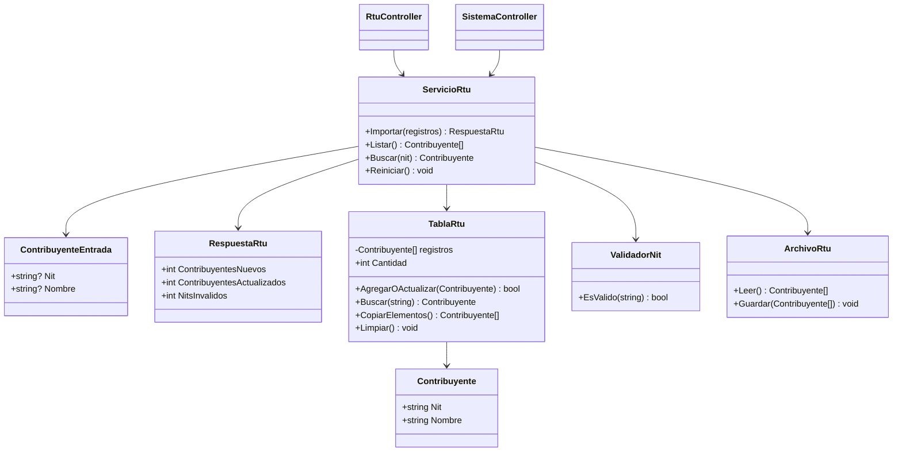
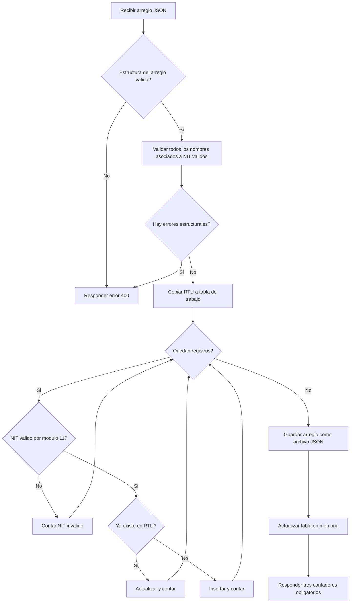
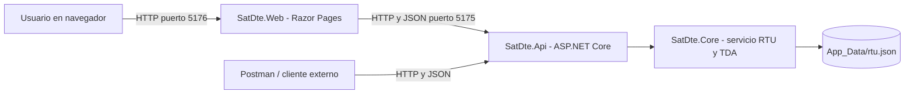

# Arquitectura preliminar — Release 1

## Separación de proyectos

- **SatDte.Web**: programa 1 del enunciado. Razor Pages, maneja archivos JSON y
  realiza llamadas HTTP reales a la API mediante `IHttpClientFactory`.
- **SatDte.Api**: servicio 2 del enunciado. API ASP.NET Core independiente,
  expone los endpoints requeridos para el módulo RTU.
- **SatDte.Core**: reglas de negocio, modelos, persistencia y TDA propia.
- **SatDte.Verificacion**: pruebas locales ejecutables sin paquetes adicionales.

## Diagrama de clases (preliminar)

## Diagrama de actividad: importación RTU

## Diagrama de despliegue (primera versión)

## Persistencia

El RTU se guarda en un archivo `rtu.json` del backend usando
`System.Text.Json`. El guardado escribe un archivo temporal y lo reemplaza
para reducir el riesgo de dejar un archivo incompleto. El servicio serializa
las escrituras mediante `lock`, y recarga el archivo cuando arranca.

## Compromisos de posteriores releases

Los diagramas se completarán con facturas, correlativos, reportes y PDF.
El documento final deberá ser un ensayo de 4-7 páginas de contenido más
anexos de acuerdo con las instrucciones del curso.
